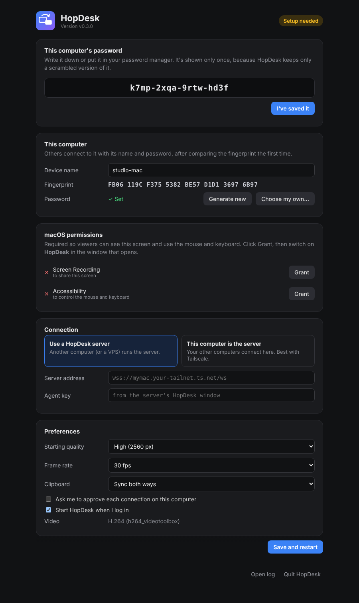
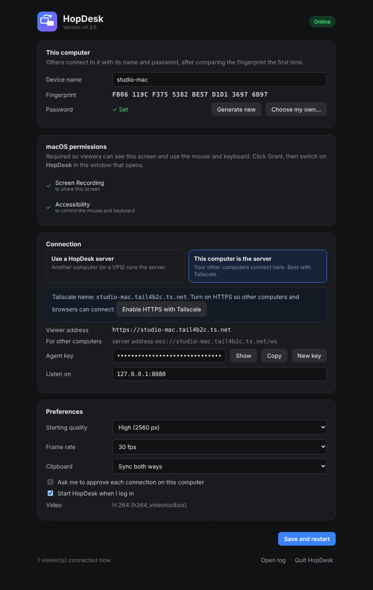
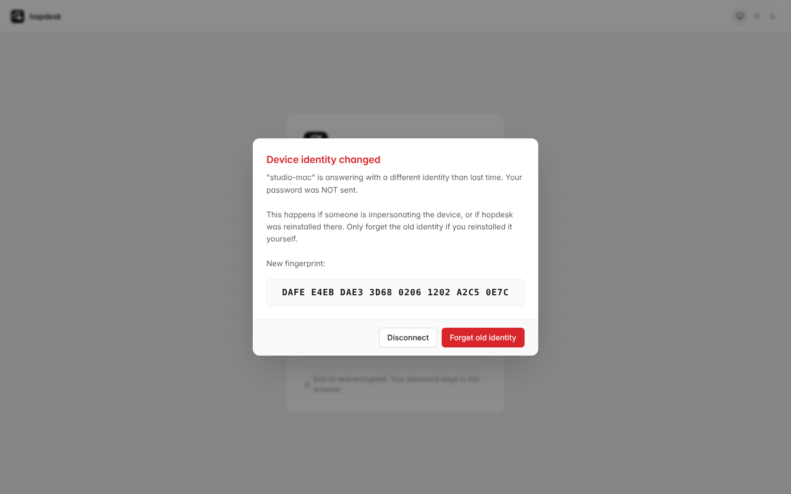

<p align="center">
  
</p>
<h1 align="center">hopdesk</h1>
<p align="center">
  Your own remote desktop. Self-hosted, encrypted, and small enough to read in an afternoon.<br><br>
  <a href="#features">Features</a> •
  <a href="#desktop-app">Desktop app</a> •
  <a href="#quick-start-command-line">Command line</a> •
  <a href="#build">Build</a> •
  <a href="#video-quality">Video quality</a> •
  <a href="#connecting-across-countries">Across countries</a> •
  <a href="#file-structure">Structure</a> •
  <a href="#security">Security</a> •
  <a href="#screenshots">Screenshots</a> •
  <a href="#testing">Testing</a>
</p>

<p align="center">
  
  
  
  
</p>

> [!CAUTION]
> **Only use hopdesk on computers you own or have permission to access.** Anyone with a device's password can see its screen, control it, and read its files.

hopdesk is a personal alternative to RustDesk, TeamViewer and AnyDesk. Install the HopDesk app on the computers you want to reach (one of them can be the server), then connect from any browser. There are no accounts and no third-party cloud, and the screen goes straight from one computer to the other.

<p align="center">
  <a href="docs/images/session.png"></a>
</p>

## Features

- **Desktop app for macOS and Windows**: a `.dmg` and an installer, a menu-bar/tray icon, a setup page with one-click permission prompts, start at login, and an optional built-in server.
- **High-quality video**: H.264 up to native resolution (4K) and 60 fps, High profile on Chrome, Edge and Safari, through ffmpeg with the Mac's hardware encoder. It falls back to JPEG frames if ffmpeg isn't available.
- **Full control**: mouse (click, drag, right-click, scroll) and keyboard with shortcuts. Cmd→Ctrl mapping for Mac-to-Windows.
- **Multi-monitor, quality and frame rate**, switchable live from the viewer.
- **Clipboard sync** (text) in both directions.
- **File transfer**: drop files on the screen to send them, or browse the remote computer and download.
- **Secure by design**: WebRTC (DTLS) encryption, plus each agent has its own identity key that the viewer remembers, like SSH. Your password is never sent anywhere: the viewer proves it knows the password, and that proof is tied to the one connection. A hostile server, a man in the middle, or an impostor agent gets nothing it can use. [Details below](#security).
- **Nothing to install on the viewing side.** It's a web page.

## How it works

<p align="center"></p>

| Part | Runs on | Does |
|---|---|---|
| **Server** (`internal/server`) | anywhere both sides can reach, or built into one HopDesk app | lets viewers find agents by ID, serves the viewer page |
| **Agent** (`cmd/agent`, the HopDesk app) | each computer you want to control | streams the screen, replays input, syncs clipboard, moves files |
| **Viewer** (`internal/server/web`) | your browser | shows the screen, sends input, file browser |

## Desktop app

The easiest way to use HopDesk. Download `HopDesk-…-macOS.dmg` or `HopDesk-…-Windows-Setup.exe` from the [Releases](../../releases) page, or [build them yourself](#build-the-installers).

**macOS:** open the `.dmg` and drag **HopDesk** to Applications. The builds aren't notarized by Apple (that needs a paid developer account), so the first time, open it, then go to **System Settings → Privacy & Security** and click **Open Anyway**. HopDesk lives in the menu bar.

**Windows:** run the installer. It installs for your user only, with no admin rights needed, and includes ffmpeg for H.264 video. Windows SmartScreen may warn about an unsigned app: click **More info → Run anyway**. HopDesk lives in the notification area by the clock.

The app opens its **setup page** in your browser:
1. **Save the password** it shows (it's shown once).
2. **macOS:** click **Grant** for Screen Recording and Accessibility, switch HopDesk on in the window that opens, then click **Restart HopDesk**.
3. **Choose how this computer connects:**
   - **This computer is the server:** pick this on the computer that's on most of the time. With [Tailscale](https://tailscale.com) installed, click **Enable HTTPS with Tailscale**. The page then shows the viewer address and the server address plus agent key for your other computers.
   - **Use a HopDesk server:** paste the server address and agent key from the server's setup page.
4. Click **Save and restart**. The menu-bar/tray icon shows **Online as <name>**.

Then open the viewer address in a browser on any of your devices, and enter the computer's name and password.

<p align="center">
  <a href="docs/images/app-setup.png"></a>
  <a href="docs/images/app-host.png"></a>
</p>

Good to know:
- **Unsigned Mac builds:** macOS ties the permissions to the exact build, so after updating to a new version you may need to switch Screen Recording and Accessibility off and on again. Signed builds keep them.
- **Settings** are kept in `~/Library/Application Support/hopdesk` (macOS) or `%APPDATA%\hopdesk` (Windows), including this computer's identity. Reinstalling keeps the same fingerprint.
- **The log** is in the same folder: **Open log** on the setup page.

## Quick start (command line)

```sh
git clone https://github.com/YOUR-USERNAME/hopdesk.git && cd hopdesk
go mod tidy

# 1. the server (secrets go in environment variables, not on the command line)
export HOPDESK_AGENT_KEY="$(openssl rand -hex 24)"
go run ./cmd/server

# 2. the agent, on the computer to control (macOS: brew install ffmpeg for H.264)
HOPDESK_KEY="$HOPDESK_AGENT_KEY" go run ./cmd/agent -id mymac
#    first run prints a password (save it) and the computer's identity fingerprint

# 3. the viewer
open http://localhost:8080      # enter "mymac" and the password
```

The first time you connect, the viewer shows the agent's **fingerprint**. Check that it matches the one the agent printed, then confirm. After that it's remembered, and you're warned loudly if it ever changes.

> The viewer only runs on a secure page: `https://`, or `http://localhost`. Browsers only provide the cryptography it needs there, and it stops anyone on the network from tampering with the page. See [Connecting across countries](#connecting-across-countries) for the easy HTTPS setup.

On a Mac, allow **Screen Recording** and **Accessibility** for Terminal (or whatever runs the agent) in **System Settings → Privacy & Security**, then restart the agent.

## Build

You need Go 1.22+. The Mac agent also needs the Xcode command line tools (`xcode-select --install`).

```sh
go build -o hopdesk-server ./cmd/server                                   # server (pure Go)
GOOS=linux GOARCH=amd64 go build -o hopdesk-server-linux ./cmd/server     # server for a Linux VPS
go build -o hopdesk-agent ./cmd/agent                                     # Mac agent (build on the Mac)
GOOS=windows GOARCH=amd64 go build -o hopdesk-agent.exe ./cmd/agent       # Windows agent (from any OS)
```

**ffmpeg** (for H.264 video, on the controlled computer): `brew install ffmpeg` on macOS, or `winget install Gyan.FFmpeg` on Windows. The agent log says which mode it picked, e.g. `video: H.264 with ffmpeg encoder h264_videotoolbox`.

### Server flags

| Flag | Default | Meaning |
|---|---|---|
| `-addr` | `:8080` | listen address |
| env `HOPDESK_AGENT_KEY` | random, printed | secret that agents need to register (16+ characters) |
| `-stun` | Google's public STUN | STUN server (`""` to disable) |
| `-turn` + env `HOPDESK_TURN_SECRET` | none | TURN relay, with short-lived credentials (coturn `use-auth-secret`) |
| `-tls-cert`, `-tls-key` | none | serve HTTPS/WSS directly |
| `-behind-proxy` | off | trust `X-Forwarded-*` from a proxy on the same machine (tailscale serve, Caddy) |
| `-allow-origin` | none | extra viewer address(es) to accept, if your proxy rewrites the host |

### Agent flags

| Flag | Default | Meaning |
|---|---|---|
| `-server` | `ws://localhost:8080/ws` | server address. Plain `ws://` is only allowed to private and Tailscale addresses, so use `wss://` |
| env `HOPDESK_KEY` | required | the server's agent key |
| `-id` | hostname | the ID you type in the viewer |
| env `HOPDESK_PASSWORD` | generated once and saved | connection password (10+ characters). Without it, the agent makes one up on first run, shows it once and keeps only a hash |
| `-reset-password` | | generate a new password |
| `-confirm` | off | ask the person at the computer to approve each connection (dialog, denies after 30 s) |
| `-idle` | `30m` | disconnect viewers after this long without input (`0` = never) |
| `-clipboard` | `both` | `both`, `to-remote` (only viewer → this computer), or `off` |
| `-state` | user config folder | where the identity key file lives |
| `-quality` | `high` | `low`, `medium`, `high` or `ultra` (see [Video quality](#video-quality)) |
| `-fps` | `30` | 5, 10, 15, 20, 30 or 60 |
| `-display` | `0` | display to show first |
| `-codec` | `auto` | `auto`, `h264` or `jpeg` |
| `-ffmpeg`, `-encoder` | auto | ffmpeg path and encoder override |
| `-upload-dir` | `~/Downloads` | where files sent from the viewer are saved |

### Build the installers

**Automatically on GitHub:** push a version tag and GitHub Actions builds the macOS `.dmg` and the Windows installer, then attaches them to a Release:

```sh
git tag v0.3.0 && git push --tags
```

You can also run the **Build installers** workflow by hand from the Actions tab to get them as downloadable artifacts.

**On your Mac:**

```sh
bash scripts/build-macos.sh                    # → dist/HopDesk-<version>-macOS.dmg
brew install makensis && bash scripts/build-windows.sh   # → dist/HopDesk-<version>-Windows-Setup.exe
```

**Signing (optional, paid):** with an Apple Developer ID, set the `MACOS_SIGN_IDENTITY`, `APPLE_ID`, `APPLE_TEAM_ID` and `APPLE_APP_PASSWORD` secrets in the repository. The workflow then signs and notarizes the app, so there's no "Open Anyway" step and permissions survive updates.

The Windows installer bundles an [LGPL build of ffmpeg](https://github.com/BtbN/FFmpeg-Builds) (its license is installed next to it). Set `WITH_FFMPEG=0` to leave it out.

## Video quality

The viewer starts at **High quality, 30 fps**, and you can change both while connected.

| Quality | Resolution | H.264 bitrate at 30 fps |
|---|---|---|
| Low | up to 1280 px wide | 1.5 Mbps |
| Medium | up to 1920 px wide | 4 Mbps |
| High (default) | up to 2560 px wide | 8 Mbps |
| Ultra | native resolution (up to 4K) | 16 Mbps |

At 60 fps the bitrate goes up by half. On Chrome, Edge and Safari, HopDesk uses H.264 **High profile** (sharper at the same bitrate). Firefox gets Baseline. Screens are downscaled with a bilinear filter, which keeps small text readable, and frames are only sent as fast as the connection allows, so a slow link lowers the frame rate rather than adding lag.

For the best picture:
- **Install ffmpeg** on the controlled computer. The Mac app uses Homebrew's (`brew install ffmpeg`), and the Windows installer includes one.
- **Use a fast connection:** Ultra at 60 fps needs about 25 Mbps of upload on the controlled computer.

## Connecting across countries

Both sides must reach the server, and WebRTC must reach **each other**. Behind home routers and carrier-grade NAT, a direct path often fails.

**Option A: Tailscale (easiest, free).** Install Tailscale on every device and sign in with one account. On the computer running the server, turn on MagicDNS and HTTPS certificates in the Tailscale admin console, then:

```sh
./hopdesk-server -addr 127.0.0.1:8080 -behind-proxy
tailscale serve --bg 8080        # HTTPS with a real certificate, only inside your tailnet
```

Open `https://<that-machine>.<your-tailnet>.ts.net` to view, and point agents at `wss://<that-machine>.<your-tailnet>.ts.net/ws`. You don't need open ports or a relay.

**Option B: a small VPS.** Run `hopdesk-server` with TLS plus **coturn** as a TURN relay:

```sh
./hopdesk-server -addr :443 -tls-cert cert.pem -tls-key key.pem \
  -agent-key ... -turn turn:your.vps:3478 -turn-user hop -turn-pass ...
```

Agents use `wss://your.vps/ws`, and you open `https://your.vps`. Open TCP 443 and TCP/UDP 3478 (plus coturn's relay ports).

## File structure

- **[cmd/server](cmd/server)**: the standalone server command
- **[internal/server](internal/server)**: the server itself (rate limits, origin checks) and the viewer ([index.html](internal/server/web/index.html), [viewer.js](internal/server/web/viewer.js)), shared by the command and the app
- **[cmd/agent](cmd/agent)**: the agent, which is also the HopDesk desktop app
  - `main.go`: sessions, authentication steps, control messages, command-line mode
  - `app.go`, `appui.go`, [`appui/`](cmd/agent/appui): desktop app mode and its token-protected setup page
  - `tray.go`: the menu-bar / notification-area icon
  - `perms_darwin.go`: macOS permission checks and prompts
  - `system_*.go`: start at login, restart, opening links
  - `tailscale.go`: finds this computer's Tailscale name and turns on `tailscale serve`
  - `identity.go`: the agent's identity key and stored password key
  - `guard.go`: password lockouts and session caps
  - `stream_h264.go`: ffmpeg → RTP → WebRTC video
  - `capture.go`: screen capture, JPEG fallback stream
  - `input_darwin.go` / `input_windows.go`: mouse and keyboard injection
  - `notify_*.go`: session notifications and the `-confirm` prompt
  - `clipboard.go`, `files.go`: clipboard sync, upload/download/browse
- **[packaging](packaging)**, **[scripts](scripts)**, **[.github/workflows](.github/workflows)**: app icon, macOS bundle, Windows installer, build scripts and the release workflow
- **[internal/auth](internal/auth)**: identity signatures and password proofs (standard library only, with tests)
- **[internal/proto](internal/proto)**: signaling messages shared by server and agent
- **[test/e2e](test/e2e)**: end-to-end and attack tests, stand-in agent, Go/browser crypto cross-check
- **[docs/images](docs/images)**: logo, diagram, screenshots

## Screenshots

**Connecting**

[](docs/images/login.png)

**Controlling a remote computer**

[](docs/images/session.png)

**Browsing, downloading and sending files**

[](docs/images/files.png)

**First connection: compare the fingerprint**

[](docs/images/first-connect.png)

**An impostor answering as your device is caught before your password is used**

[](docs/images/impostor-warning.png)

> The screenshots come from the end-to-end test. The "remote computer" in them is a demo desktop drawn by the test's stand-in agent.

## Testing

```sh
go test ./...                                   # auth, lockouts, URL policy, file names, identity file, setup-page security
go build -o hopdesk-server ./cmd/server
pip install playwright && playwright install chromium
python3 test/e2e/run.py                         # 31 end-to-end checks, including attacks
python3 test/e2e/crosscheck.py                  # Go and browser crypto agree exactly
```

`test/e2e/run.py` starts the real server and drives the real viewer in Chrome against a stand-in agent that speaks the full agent protocol. It covers:
- **Features:** video, mouse position, keyboard, clipboard, settings, file browser, and byte-exact uploads and downloads.
- **Attacks:** an impostor agent, a man in the middle, cross-site WebSockets, connection floods, agent-key guessing, wrong passwords, clickjacking headers, and running the viewer over plain HTTP.

Set `SCREENSHOTS=docs/images` to refresh the screenshots.

The tests don't cover the agent's screen capture, input injection or ffmpeg on a real desktop. Check those by hand on a Mac and a Windows PC.

## Limitations

- No audio. The clipboard is text only (up to about 60 KB).
- Text copied on the remote shows up with a **Copy here** button. It never replaces your clipboard on its own, because a compromised remote could otherwise swap in a malicious command for you to paste.
- Downloads are held in browser memory until complete, so multi-GB files may fail. Uploads stream to disk.
- The keyboard uses a US-layout physical key map, with other characters typed directly. The browser keeps a few shortcuts (Cmd+W, Cmd+Q, Cmd+Tab).
- Windows: admin (UAC) windows and the login screen need the agent to run as administrator or as a service. macOS: works while a user is logged in.
- On Windows, the bundled ffmpeg encodes with Media Foundation (`h264_mf`). If that fails on a particular PC, HopDesk falls back to JPEG frames: install a full ffmpeg build with x264 next to `HopDesk.exe` for the best quality.

## Security

How hopdesk handles each threat:

| Threat | Protection |
|---|---|
| Someone listening on the network | WebRTC encryption (DTLS-SRTP). The viewer needs HTTPS, and agents refuse plain `ws://` to public addresses. |
| A hostile or hacked server, or a man in the middle | The agent signs a statement tied to the exact encrypted connection (its DTLS fingerprints). The viewer's password proof is tied to it too, so a relayed or intercepted connection fails on both sides. |
| An impostor agent answering as your device | Each agent has its own Ed25519 identity, and the viewer remembers it after the first connection. A different identity triggers a red warning **before** anything password-related is sent. |
| Stolen password | The password is never transmitted. The viewer sends an HMAC proof using a PBKDF2 key (600,000 iterations), different for every connection, so it can't be replayed. The agent stores only the derived key, in a file only its user can read. |
| Password guessing | One attempt per connection. 5 wrong passwords block that address for 15 min, doubling each time, and other addresses (yours) are unaffected. There's also a cap of 30 failures per hour from everywhere combined. |
| Floods and resource exhaustion | Per-address limits on connections and attempts at the server, per-device limits, at most 3 unauthenticated sessions per agent, and timeouts. |
| Malicious websites using your browser | WebSocket Origin checks, a strict Content-Security-Policy, no framing, and no inline script. |
| Being watched unnoticed | A desktop notification when a session starts and ends, optional approve/deny prompt (`-confirm`), and an idle disconnect. |
| Clipboard attacks | The remote clipboard is only copied when you click. `-clipboard` can limit or disable sync. |
| Secrets leaking | Secrets come from environment variables, not command-line flags (warned if used), and TURN credentials are short-lived. |
| The app's setup page | Listens on this computer only, needs a random token for every request, and checks Host and Origin, so other websites and other users can't change settings. |
| Malicious file names | Uploads are stripped of folders, reserved Windows names are renamed, and existing files are never overwritten. |

What's still up to you:
- **First connection:** compare the fingerprint the viewer shows with the one the agent printed. That one check is what makes impostors detectable later.
- **The server serves the viewer page**, so run your own server and reach it over HTTPS.
- **Anyone with the password has full control**, including your files. Use the generated password, or a long one, and `-confirm` on shared computers.
- **The 30-per-hour cap** means a determined attacker spread across many addresses can pause new logins for a while, though not break in. If that happens, the agent log shows it.
- **This is a personal project and has not had a professional security audit.**
