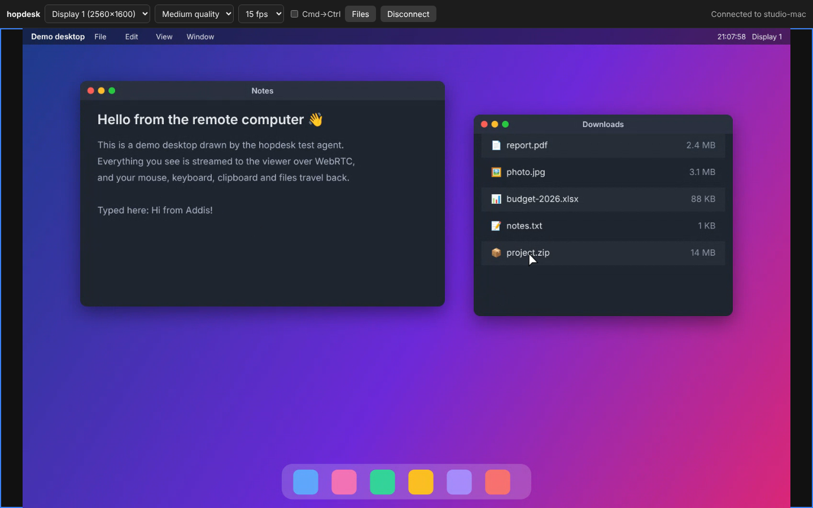
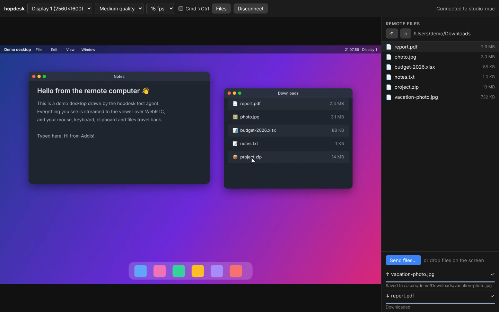

<p align="center">
  
</p>
<h1 align="center">hopdesk</h1>
<p align="center">
  Your own remote desktop. Self-hosted, encrypted, and small enough to read in an afternoon.<br><br>
  <a href="#features">Features</a> •
  <a href="#quick-start">Quick start</a> •
  <a href="#build">Build</a> •
  <a href="#connecting-across-countries">Across countries</a> •
  <a href="#file-structure">Structure</a> •
  <a href="#screenshots">Screenshots</a> •
  <a href="#testing">Testing</a>
</p>

<p align="center">
  
  
  
  
</p>

> [!CAUTION]
> **Only use hopdesk on computers you own or have permission to access.** Anyone with a device's password can see its screen, control it, and read its files.

hopdesk is a personal alternative to RustDesk, TeamViewer and AnyDesk. You run one tiny server, put an agent on the computers you want to reach, and connect from any browser. There are no accounts and no third-party cloud, and the screen goes straight from one computer to the other.

<p align="center">
  <a href="docs/images/session.png"></a>
</p>

## Features

- **Smooth H.264 video** through ffmpeg, using the Mac's hardware encoder (VideoToolbox) or x264. Without ffmpeg, it falls back to JPEG frames automatically.
- **Full control**: mouse (click, drag, right-click, scroll) and keyboard with shortcuts. Cmd→Ctrl mapping for Mac-to-Windows.
- **Multi-monitor, quality and frame rate**, switchable live from the viewer.
- **Clipboard sync** (text) in both directions.
- **File transfer**: drop files on the screen to send them, or browse the remote computer and download.
- **End-to-end encrypted** (WebRTC/DTLS). The password is checked by the agent itself and never passes through the server.
- **Nothing to install on the viewing side.** It's a web page.

## How it works

<p align="center"></p>

| Part | Runs on | Does |
|---|---|---|
| **Server** (`cmd/server`) | anywhere both sides can reach | lets viewers find agents by ID, serves the viewer page |
| **Agent** (`cmd/agent`) | each computer you want to control | streams the screen, replays input, syncs clipboard, moves files |
| **Viewer** (`cmd/server/web`) | your browser | shows the screen, sends input, file browser |

## Quick start

```sh
git clone https://github.com/YOUR-USERNAME/hopdesk.git && cd hopdesk
go mod tidy

# 1. the server
go run ./cmd/server -agent-key PICK-A-LONG-SECRET

# 2. the agent, on the computer to control (macOS: brew install ffmpeg for H.264)
go run ./cmd/agent -key PICK-A-LONG-SECRET -id mymac -password 'a-strong-password'

# 3. the viewer
open http://localhost:8080      # enter "mymac" and the password
```

On a Mac, allow **Screen Recording** and **Accessibility** for Terminal (or whatever runs the agent) in **System Settings → Privacy & Security**, then restart the agent.

## Build

You need Go 1.22+. The Mac agent also needs the Xcode command line tools (`xcode-select --install`).

```sh
go build -o hopdesk-server ./cmd/server                                   # server (pure Go)
GOOS=linux GOARCH=amd64 go build -o hopdesk-server-linux ./cmd/server     # server for a Linux VPS
go build -o hopdesk-agent ./cmd/agent                                     # Mac agent (build on the Mac)
GOOS=windows GOARCH=amd64 go build -o hopdesk-agent.exe ./cmd/agent       # Windows agent (from any OS)
```

**ffmpeg** (for H.264 video, on the controlled computer): `brew install ffmpeg` on macOS, or `winget install Gyan.FFmpeg` on Windows. The agent log says which mode it picked, e.g. `video: H.264 with ffmpeg encoder h264_videotoolbox`.

### Server flags

| Flag | Default | Meaning |
|---|---|---|
| `-addr` | `:8080` | listen address |
| `-agent-key` | random, printed | secret that agents need to register |
| `-stun` | Google's public STUN | STUN server (`""` to disable) |
| `-turn`, `-turn-user`, `-turn-pass` | none | TURN relay for networks that block direct connections |
| `-tls-cert`, `-tls-key` | none | serve HTTPS/WSS |

### Agent flags

| Flag | Default | Meaning |
|---|---|---|
| `-server` | `ws://localhost:8080/ws` | server address (`wss://` with TLS) |
| `-key` | required | the server's agent key |
| `-id` | hostname | the ID you type in the viewer |
| `-password` | random, printed | connection password (8+ characters) |
| `-quality` | `medium` | `low` (1280px, 0.8 Mbps), `medium` (1600px, 2 Mbps), `high` (2560px, 5 Mbps) |
| `-fps` | `15` | 5, 10, 15, 20 or 30 |
| `-display` | `0` | display to show first |
| `-codec` | `auto` | `auto`, `h264` or `jpeg` |
| `-ffmpeg`, `-encoder` | auto | ffmpeg path and encoder override |
| `-upload-dir` | `~/Downloads` | where files sent from the viewer are saved |

## Connecting across countries

Both sides must reach the server, and WebRTC must reach **each other**. Behind home routers and carrier-grade NAT, a direct path often fails.

**Option A: Tailscale (easiest, free).** Install Tailscale on every device, sign in with one account, run the server on any of them, and use its `100.x.y.z` address everywhere. You don't need open ports or a relay.

**Option B: a small VPS.** Run `hopdesk-server` with TLS plus **coturn** as a TURN relay:

```sh
./hopdesk-server -addr :443 -tls-cert cert.pem -tls-key key.pem \
  -agent-key ... -turn turn:your.vps:3478 -turn-user hop -turn-pass ...
```

Agents use `wss://your.vps/ws`, and you open `https://your.vps`. Open TCP 443 and TCP/UDP 3478 (plus coturn's relay ports).

## File structure

- **[cmd/server](cmd/server)**: signaling server, plus the viewer page embedded from [cmd/server/web](cmd/server/web)
- **[cmd/agent](cmd/agent)**: the agent
  - `main.go`: sessions, password check, control messages
  - `stream_h264.go`: ffmpeg → RTP → WebRTC video
  - `capture.go`: screen capture, JPEG fallback stream
  - `input_darwin.go` / `input_windows.go`: mouse and keyboard injection
  - `clipboard.go`, `files.go`: clipboard sync, upload/download/browse
- **[internal/proto](internal/proto)**: signaling messages shared by server and agent
- **[test/e2e](test/e2e)**: end-to-end browser test and a stand-in agent
- **[docs/images](docs/images)**: logo, diagram, screenshots

## Screenshots

**Connecting**

[](docs/images/login.png)

**Controlling a remote computer**

[](docs/images/session.png)

**Browsing, downloading and sending files**

[](docs/images/files.png)

> The screenshots come from the end-to-end test. The "remote computer" in them is a demo desktop drawn by the test's stand-in agent.

## Testing

`test/e2e/run.py` starts the real server and drives the real viewer in Chrome against a stand-in agent that speaks the agent protocol. It checks 25 things: agent keys and duplicate IDs, wrong passwords, video, mouse position, keyboard and modifiers, clipboard in both directions, live settings, the file browser, and byte-exact upload and download.

```sh
go build -o hopdesk-server ./cmd/server
pip install playwright && playwright install chromium
python3 test/e2e/run.py            # SCREENSHOTS=docs/images to refresh the screenshots
```

The test doesn't cover the Go agent itself (screen capture, input injection, ffmpeg). Check those by hand on a Mac and a Windows PC.

## Limitations

- No audio. The clipboard is text only (up to about 60 KB).
- Over plain `http://` (not localhost), browsers block automatic clipboard writes, so the viewer shows a **Copy here** button instead.
- Downloads are held in browser memory until complete, so multi-GB files may fail. Uploads stream to disk.
- The keyboard uses a US-layout physical key map, with other characters typed directly. The browser keeps a few shortcuts (Cmd+W, Cmd+Q, Cmd+Tab).
- Windows: admin (UAC) windows and the login screen need the agent to run as administrator or as a service. macOS: works while a user is logged in.

## Security

- Use a long agent key and a strong password per device. After 5 wrong passwords, the agent locks for a minute.
- A connected viewer can browse and download any file the agent's user can read.
- Use Tailscale or TLS outside your home network. This is a personal project and has not been audited.
