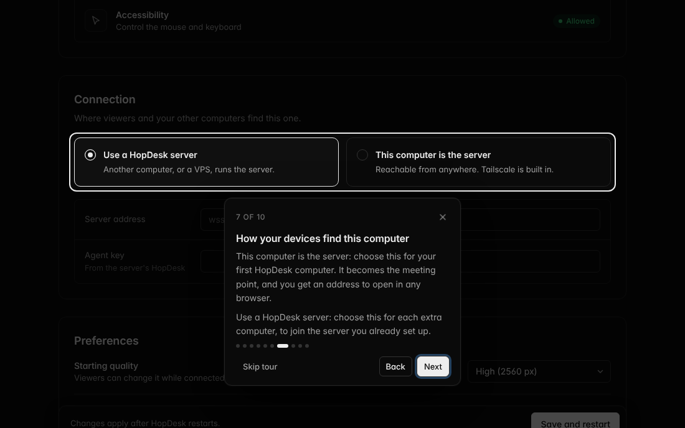
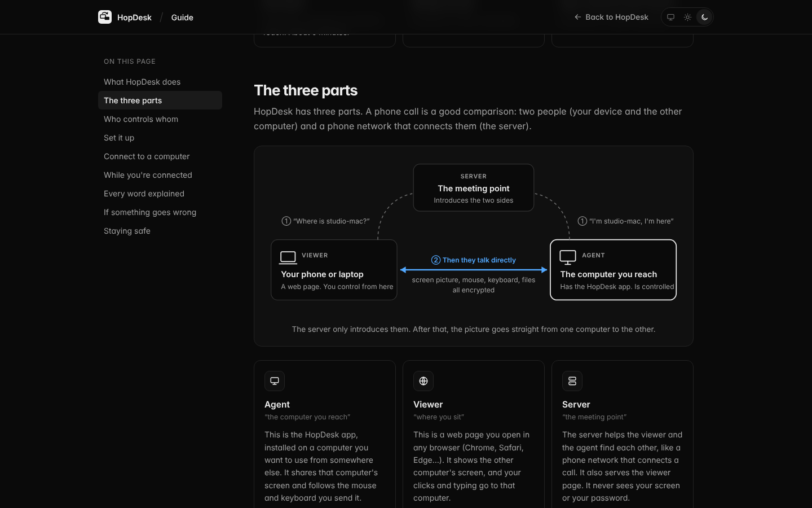
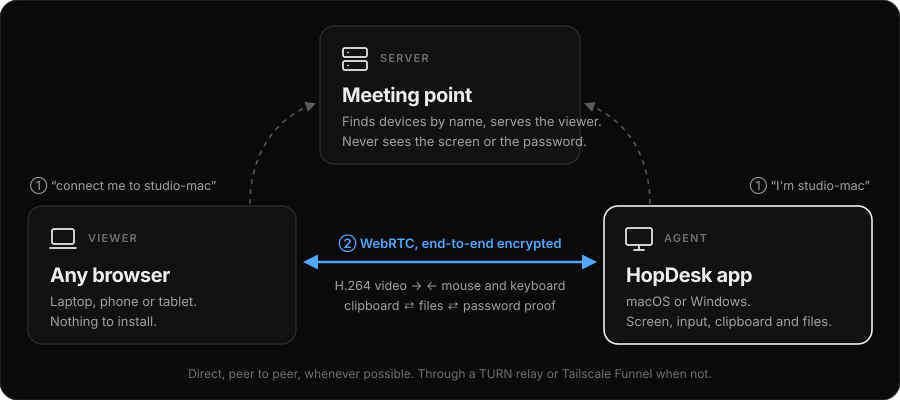
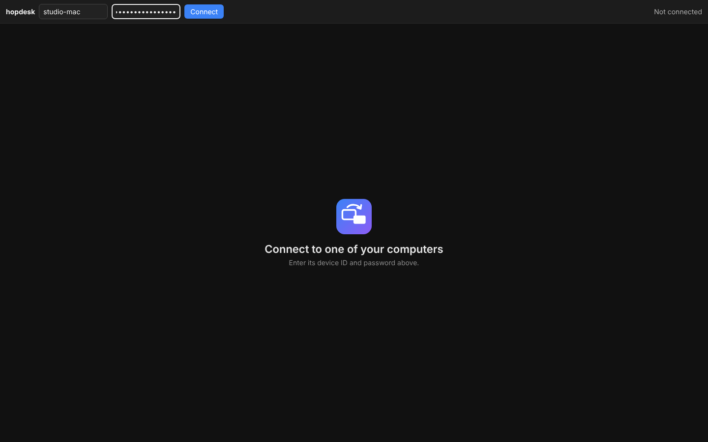
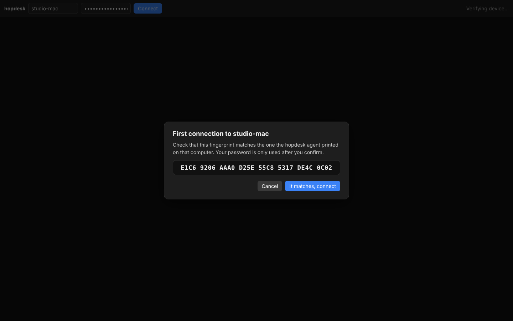
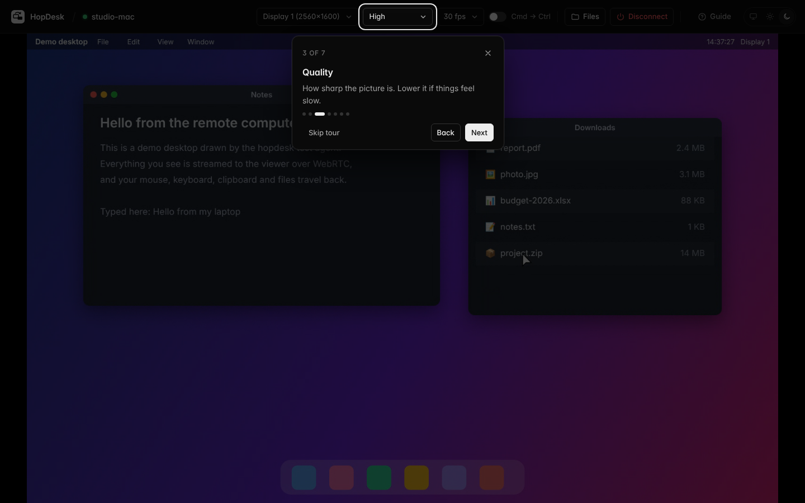
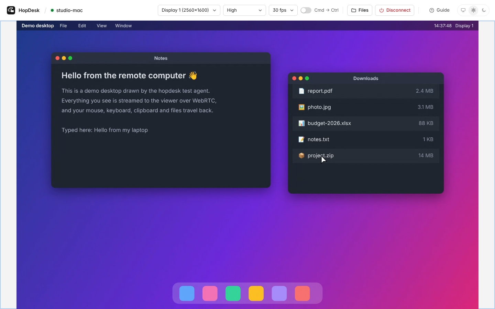

<p align="center">
  <a href="https://github.com/gadisaka/hopdesk"></a>
</p>

<h1 align="center">HopDesk</h1>

<p align="center">
  <b>Your own remote desktop.</b> Self-hosted, end-to-end encrypted, and nothing to install on the viewing side.
</p>

<p align="center">
  <a href="#getting-started">Getting started</a> •
  <a href="#how-it-works">How it works</a> •
  <a href="#build">Build</a> •
  <a href="#documentation">Docs</a> •
  <a href="#file-structure">Structure</a> •
  <a href="#screenshots">Screenshots</a> •
  <a href="SECURITY.md">Security</a>
</p>

<p align="center">
  <a href="https://github.com/gadisaka/hopdesk/releases/latest"></a>
  <a href="https://github.com/gadisaka/hopdesk/actions/workflows/release.yml"></a>
  <a href="https://github.com/gadisaka/hopdesk/releases"></a>
  
  
  
  <a href="LICENSE"></a>
</p>

> [!CAUTION]
> **Misuse disclaimer:** only use HopDesk on computers you own or have permission to access. Anyone with a device's password can see its screen, control it and read its files. If someone you don't know asks you to install HopDesk or read out a password, it's a scam.

HopDesk is a remote desktop you run yourself, an open alternative to TeamViewer, AnyDesk and [RustDesk](https://github.com/rustdesk/rustdesk). Install the app on the computers you want to reach, then connect from any browser, anywhere. There are no accounts and no third-party cloud. The server only introduces the two sides, and the screen goes straight from one computer to the other, encrypted end to end. It's written in Go, built on [Pion WebRTC](https://github.com/pion/webrtc), and has [Tailscale](https://tailscale.com) built in, so one click makes a computer reachable from anywhere.

<p align="center">
  <picture>
    <source media="(prefers-color-scheme: light)" srcset="docs/images/session-light.png">
    
  </picture>
</p>

<p align="center">
  <b><a href="https://github.com/gadisaka/hopdesk/releases/latest">DOWNLOAD</a></b> •
  <b><a href="#getting-started">GET STARTED</a></b> •
  <b><a href="#documentation">DOCUMENTATION</a></b> •
  <b><a href="https://github.com/gadisaka/hopdesk/issues/new">REPORT A BUG</a></b>
</p>

## Features

| Feature | What you get |
|---|---|
| **Desktop app** | A `.dmg` for macOS and an installer for Windows. Lives in the menu bar or tray, with one-click permission prompts and start at login. |
| **Reachable from anywhere** | Tailscale is built in. Sign in once and get an `https://` address that works from any browser, with no ports or router settings. |
| **Sharp, fast video** | H.264 up to native resolution (4K) at up to 60 fps, using the hardware encoder where available, with automatic fallback. |
| **Full control** | Mouse, keyboard and shortcuts, multiple monitors, and Cmd → Ctrl mapping for Mac-to-Windows. |
| **Works on your phone** | Touchpad or direct touch, two-finger scroll and right-click, pinch to zoom, a Rotate button for a bigger, sideways picture, and a keyboard with Esc, Tab, Ctrl, Alt, Cmd and the arrows. |
| **Clipboard and files** | Copy and paste in both directions. Drop files on the screen to send them, or browse the remote computer and download. |
| **Secure by design** | WebRTC encryption, a per-device identity key the viewer remembers (like SSH), and a password that's never sent anywhere. [Threat model →](SECURITY.md) |
| **Friendly for everyone** | A built-in plain-language guide, a short first-run tour you can skip, Copy buttons everywhere, and light and dark themes. |
| **Automatic updates** | Checks daily and installs in one click. Every release is signed, and only a genuine, newer version is installed. |
| **Small and readable** | No accounts and no telemetry. Small enough to read in an afternoon. |

## Getting started

**1. Download** the app for the computer you want to reach from the [latest release](https://github.com/gadisaka/hopdesk/releases/latest):

| Platform | File | Notes |
|---|---|---|
| macOS 13+ (Apple silicon and Intel) | `HopDesk-<version>-macOS.dmg` | Drag to Applications. The first time, allow it in **System Settings → Privacy & Security → Open Anyway** (the build isn't notarized). |
| Windows 10/11 (64-bit) | `HopDesk-<version>-Windows-Setup.exe` | Installs for your user only, with no admin rights needed. If SmartScreen warns, click **More info → Run anyway**. |

**2. Follow the setup page.** It opens on its own, and a short tour explains each part:

1. **Save the password** it shows. It's shown only once.
2. **On a Mac,** click **Grant** for Screen Recording and Accessibility, then **Restart HopDesk**.
3. Choose **This computer is the server**, click **Save and restart**, and **sign in to Tailscale** (free).
4. Copy the address next to **Open in any browser**.

**3. Connect.** Open that address on your phone or laptop, then type the device name and password. The first time, check that the fingerprint matches the one in the app.

To add more computers, install HopDesk on each one and choose **Use a HopDesk server**. Paste in the server address and agent key, which both have Copy buttons on the server's settings page.

> [!TIP]
> New to remote desktops? Click **How it works** in the app or **Guide** in the viewer. It explains which computer controls which, and every word on the screen, without jargon.

<p align="center">
  <picture>
    <source media="(prefers-color-scheme: light)" srcset="docs/images/tour-light.png">
    
  </picture>
  <picture>
    <source media="(prefers-color-scheme: light)" srcset="docs/images/guide-light.png">
    
  </picture>
</p>

## How it works

<p align="center">
  <picture>
    <source media="(prefers-color-scheme: light)" srcset="docs/images/architecture-light.svg">
    
  </picture>
</p>

| Part | What it is | Runs on |
|---|---|---|
| **Agent** | The HopDesk app. Shares the screen and replays the mouse, keyboard, clipboard and files. | Every computer you want to reach (macOS, Windows) |
| **Viewer** | A web page that shows the screen and sends your input. | Any modern browser, on any device |
| **Server** | Signaling: lets viewers find agents by name and serves the viewer page. Never sees the screen or the password. | Built into one HopDesk app, or [standalone](docs/command-line.md) on a VPS |

The browser always controls the computer with the app, never the other way round. To control in both directions, install HopDesk on both.

## Build

You need [Go](https://go.dev/dl/) (the version in [`go.mod`](go.mod)). On a Mac, you also need the Xcode command line tools (`xcode-select --install`).

```sh
git clone https://github.com/gadisaka/hopdesk.git && cd hopdesk

go build -o hopdesk-server ./cmd/server                              # standalone server (pure Go, any OS)
go build -o hopdesk-agent  ./cmd/agent                               # agent / desktop app (build on the Mac)
GOOS=windows GOARCH=amd64 go build -o hopdesk-agent.exe ./cmd/agent  # Windows agent (from any OS)

bash scripts/build-macos.sh       # → dist/HopDesk-<version>-macOS.dmg
bash scripts/build-windows.sh     # → dist/HopDesk-<version>-Windows-Setup.exe (needs makensis)
```

Pushing a tag (`git tag v1.0.0 && git push --tags`) makes GitHub Actions build both installers and publish a release. See [docs/building.md](docs/building.md) for signing, ffmpeg and details.

## Documentation

| Guide | What's inside |
|---|---|
| **In-app guide** ([`help.html`](internal/server/web/help.html)) | Plain-language user guide: the three parts, setup, every term, troubleshooting |
| [Connecting across countries](docs/connecting.md) | Built-in Tailscale, Tailscale on every device, or your own VPS with a TURN relay |
| [Command line](docs/command-line.md) | Running the server and agent without the app, and every flag |
| [Building](docs/building.md) | Building from source, installers, code signing, ffmpeg |
| [Video quality](docs/video-quality.md) | Quality presets, bitrates, and tips for the best picture |
| [Testing](docs/testing.md) | Unit tests, browser end-to-end and attack tests, crypto cross-check |
| [Automatic updates](docs/updates.md) | How updates are checked, verified and installed, and how to set up signing |
| [Limitations](docs/limitations.md) | What HopDesk doesn't do (yet) |
| [Security](SECURITY.md) | Threat model, design, and how to report a vulnerability |

## File structure

- **[cmd/agent](cmd/agent)**: the agent, which is also the desktop app: sessions, screen capture, H.264 streaming, input, clipboard, files, tray icon, permissions and built-in Tailscale
- **[cmd/agent/appui](cmd/agent/appui)**: the app's settings page (served only on `127.0.0.1`, with a token)
- **[cmd/server](cmd/server)**: the standalone server command
- **[internal/server](internal/server)**: the signaling server, with rate limits and origin checks, shared by the command and the app
- **[internal/server/web](internal/server/web)**: the browser viewer, the guide, and the shared design system (`ui.css`, `theme.js`, `ui.js`)
- **[internal/update](internal/update)**: signed release manifests and version comparison for automatic updates
- **[cmd/releasetool](cmd/releasetool)**: makes the update signing key and signs each release
- **[internal/auth](internal/auth)**: device identity signatures and password proofs (standard library only)
- **[internal/proto](internal/proto)**: signaling messages shared by the server and agent
- **[packaging](packaging)**, **[scripts](scripts)**, **[.github/workflows](.github/workflows)**: app icon, macOS bundle, Windows installer, build scripts and the release workflow
- **[test/e2e](test/e2e)**: end-to-end and attack tests with a stand-in agent, and a Go/browser crypto cross-check
- **[docs](docs)**: documentation and images

## Screenshots

<table>
  <tr>
    <td width="50%"><a href="docs/images/login.png"></a><p align="center"><sub>Connect from any browser</sub></p></td>
    <td width="50%"><a href="docs/images/files.png"></a><p align="center"><sub>Browse, download and send files</sub></p></td>
  </tr>
  <tr>
    <td><a href="docs/images/first-connect.png"></a><p align="center"><sub>First connection: compare the fingerprint</sub></p></td>
    <td><a href="docs/images/impostor-warning.png"></a><p align="center"><sub>An impostor is caught before your password is used</sub></p></td>
  </tr>
  <tr>
    <td><a href="docs/images/tour-session.png"></a><p align="center"><sub>A first-run tour you can skip</sub></p></td>
    <td><a href="docs/images/session-light.png"></a><p align="center"><sub>Light and dark themes</sub></p></td>
  </tr>
</table>

<sub>The screenshots come from the end-to-end tests. The "remote computer" in them is a demo desktop drawn by the stand-in agent.</sub>

## Contributing

Bug reports, ideas and pull requests are welcome. Read [CONTRIBUTING.md](CONTRIBUTING.md) to get set up, and please report security issues privately as described in [SECURITY.md](SECURITY.md).

## Acknowledgements

HopDesk stands on [Pion WebRTC](https://github.com/pion/webrtc) and [Pion TURN](https://github.com/pion/turn), [Tailscale tsnet](https://tailscale.com/kb/1244/tsnet), [FFmpeg](https://ffmpeg.org), [kbinani/screenshot](https://github.com/kbinani/screenshot), [fyne.io/systray](https://github.com/fyne-io/systray) and [Gorilla WebSocket](https://github.com/gorilla/websocket), and takes inspiration from [RustDesk](https://github.com/rustdesk/rustdesk).

## License

HopDesk is released under the [MIT License](LICENSE). The Windows installer bundles an LGPL build of FFmpeg, whose license is installed next to it.

## Author

Made by [@gadisaka](https://github.com/gadisaka). If HopDesk is useful to you, a ⭐ helps others find it.
