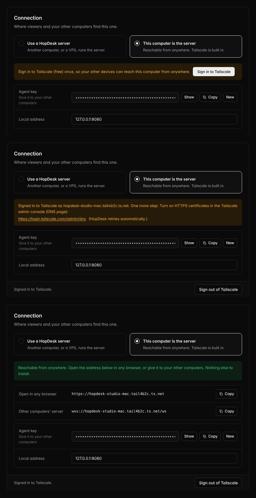

# Connecting across countries

To connect, both sides must reach the server, and WebRTC must reach **each other**. Behind home routers and carrier-grade NAT, a direct path often fails. There are three ways to solve this, easiest first.

## Option A: the desktop app's built-in Tailscale (recommended, free)

Choose **This computer is the server** in the HopDesk app and sign in to a free Tailscale account. HopDesk runs its own Tailscale node ([tsnet](https://pkg.go.dev/tailscale.com/tsnet)) and publishes the server with [Tailscale Funnel](https://tailscale.com/kb/1223/funnel):

- **Reachable from anywhere:** viewers and other computers connect to `https://hopdesk-<name>.<tailnet>.ts.net`, with nothing installed.
- **Built-in relay:** when two devices can't connect directly (for example, both are behind carrier-grade NAT), a TURN relay inside HopDesk carries the video over the same Funnel.
- **One-time setup:** your tailnet needs HTTPS certificates switched on and Funnel allowed. If either is missing, the settings page shows the exact link to fix it.
- **Relay limits:** Funnel traffic has bandwidth limits that Tailscale doesn't publish. Direct connections are always tried first and run at full quality, but relayed sessions may be capped below Ultra. For guaranteed relay quality, use Option C.

<p align="center">
  <picture>
    <source media="(prefers-color-scheme: light)" srcset="images/tailscale-steps-light.png">
    
  </picture>
</p>

## Option B: Tailscale installed on every device

This setup is private to your tailnet and doesn't use Funnel. Install Tailscale on every device and sign in with one account. On the computer that runs the server, turn on MagicDNS and HTTPS certificates in the Tailscale admin console, then run:

```sh
./hopdesk-server -addr 127.0.0.1:8080 -behind-proxy
tailscale serve --bg 8080        # HTTPS with a real certificate, only inside your tailnet
```

Open `https://<that-machine>.<your-tailnet>.ts.net` to view, and point agents at `wss://<that-machine>.<your-tailnet>.ts.net/ws`. You don't need open ports or a relay.

## Option C: a small VPS

Run `hopdesk-server` with TLS, plus [coturn](https://github.com/coturn/coturn) as a TURN relay:

```sh
export HOPDESK_AGENT_KEY="$(openssl rand -hex 24)"
export HOPDESK_TURN_SECRET="…"          # the same value as coturn's static-auth-secret
./hopdesk-server -addr :443 -tls-cert cert.pem -tls-key key.pem -turn turn:your.vps:3478
```

Agents use `wss://your.vps/ws`, and you open `https://your.vps`. Open TCP 443 and TCP/UDP 3478, plus coturn's relay port range. All flags are listed in [command-line.md](command-line.md).

## Why HTTPS is required

The viewer only runs on a secure page: `https://`, or `http://localhost`. Browsers only provide the cryptography the viewer needs on secure pages, and HTTPS also stops anyone on the network from tampering with the page itself.
